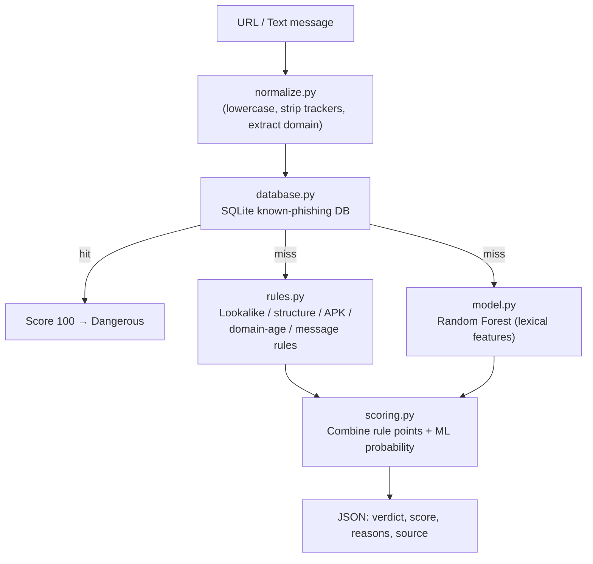

# PhishGuard

**Explainable phishing and domain-spoofing detection for Indian citizens**

Submitted for the **Seva First Innovation Challenge** — Ministry of Education, India.

---

## Project description

PhishGuard analyses a **URL or a text message** and returns an explainable JSON verdict:

```json
{
  "verdict": "Safe | Suspicious | Dangerous",
  "score": 0,
  "reasons": ["plain-language strings"],
  "source": "database | rules | ml | combined"
}
```

Focus areas:

- Indian brands and bank lookalikes
- UPI / KYC lures
- Government-portal impersonation (`.gov.in` / `.nic.in` lookalikes)
- Fake e-challan messages with `.apk` links
- Scam messages in English, Tamil, Hindi and Hinglish

**Core idea — two layers**

1. **Known-phishing SQLite database** — instant catch of previously seen threats.
2. **Rules + ML** — catch novel links and messages that blocklists have not listed yet (lookalike brands, structural signals, lexical Random Forest).

---

## Architecture



Thresholds (tuned on the **train** set only):

| Score range | Verdict |
|-------------|---------|
| 0 – 34 | Safe |
| 35 – 65 | Suspicious |
| 66 – 100 | Dangerous |

---

## Repository layout

```
phishguard/
  app/              FastAPI application (main, scoring, rules, model, …)
  data/             indian_brands.json, message_patterns.json, lure_set.csv
  data/processed/   split_meta.json, sources.json (+ CSVs after split)
  scripts/          fetch_data.py, split_data.py, build_db.py, demo_cases.md
  tests/            pytest suite
  results/          metrics.json, metrics.md, screenshots/
  web/              React + Vite single-page UI
  extension/        Chrome Manifest V3 popup extension
  train.py          Train Random Forest on train split
  evaluate.py       Held-out evaluation + integrity check
```

---

## Setup

```bash
python3 -m venv venv
source venv/bin/activate   # Windows: venv\Scripts\activate
pip install -r requirements.txt
```

### 1. Fetch data and build the database

```bash
python scripts/fetch_data.py          # downloads OpenPhish, PhishTank, Tranco → data/raw/
python scripts/split_data.py          # creates train / test / db splits (seed=42)
python scripts/build_db.py            # loads phishing_db.csv into SQLite (phishguard.db)
```

### 2. Train the model

```bash
python train.py                       # writes model artefact (gitignored)
```

### 3. Run the API

```bash
uvicorn app.main:app --reload --port 8000
```

- `GET  /health` — status, DB row count, model loaded
- `POST /check`  — body `{"input": "<url or message>"}` → verdict JSON

### 4. Run the web UI

```bash
cd web
cp .env.example .env                  # set VITE_API_BASE_URL if needed
npm install
npm run dev                           # http://localhost:5173
```

### 5. Load the Chrome extension

1. Open `chrome://extensions` → enable **Developer mode**
2. **Load unpacked** → select the `extension/` folder
3. Set the API base URL in the popup (default `http://localhost:8000`)

### 6. Run tests

```bash
pytest tests/ -v
```

### 7. Evaluate on the held-out test set

```bash
python evaluate.py
```

- Starts with a **runtime overlap check** (test vs DB / train for normalised URLs and registered domains). Aborts if any overlap is non-zero.
- Writes `results/metrics.json` and `results/metrics.md`.

---

## Data sources and download dates

Recorded in `data/processed/sources.json` (produced by `fetch_data.py`):

| Source    | URL | Download date | Notes |
|-----------|-----|---------------|-------|
| OpenPhish | https://openphish.com/feed.txt | 2026-10-22 | Community feed |
| PhishTank | https://data.phishtank.com/data/online-valid.csv | 2026-10-22 | Online-valid CSV |
| Tranco    | https://tranco-list.eu/top-1m.csv.zip | 2026-10-22 | Top 10 000 domains → benign set |

Split (seed 42) counts are in `data/processed/split_meta.json`.

`data/lure_set.csv` is a **curated** Indian-context benchmark (not scraped from real victims). See the header comment in the file.

---

## Demo cases

Exact inputs for the demo video are in **`scripts/demo_cases.md`**.

| # | Scenario |
|---|----------|
| 1 | Known / lookalike phishing URL (database or strong rules hit) |
| 2 | Bank or government lookalike domain not necessarily in the DB |
| 3 | Fake e-challan message with an `.apk` link |
| 4 | Hindi / Tamil KYC or UPI scam message |
| 5 | Genuine site (e.g. IRCTC or real bank) → Safe |

Screenshot checklist: **`results/screenshots/SCREENSHOTS.md`**.

---

## Limitations (honest)

- WHOIS / RDAP domain-age lookups need network access and can time out or return incomplete data.
- The ML model is trained on a snapshot of public phishing feeds; brand-new patterns it has never seen will have lower confidence.
- Tamil and Hindi message patterns follow the competition brief; native-speaker review is recommended before any production deployment.
- The known-phishing database is a static snapshot — rebuild periodically with `fetch_data.py` + `build_db.py`. No live feed updater is included.
- True “database hit” demos depend on the current PhishTank / OpenPhish contents; lookalike + rules cases are deterministic for the video.
- The extension only requests `localhost` host permissions by default; remote APIs need a one-line `host_permissions` change.

---

## License

MIT
