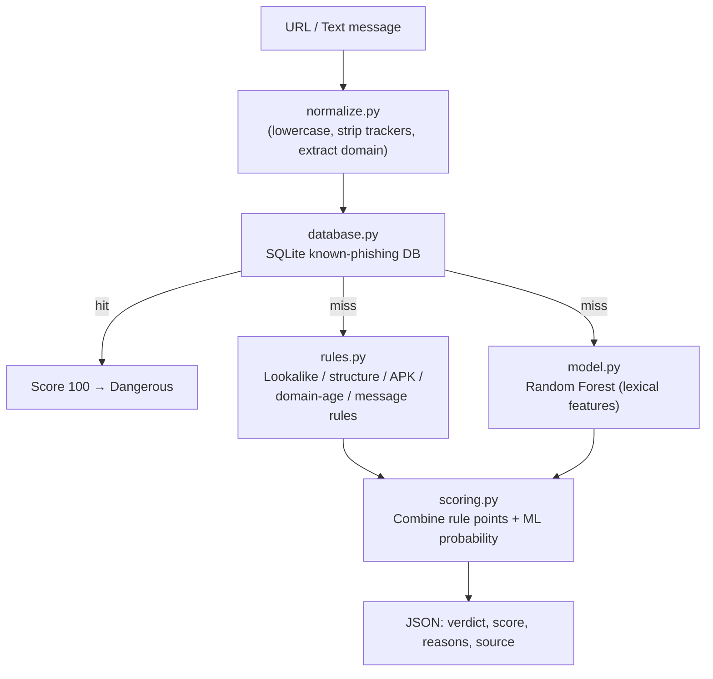

# PhishGuard

**Explainable phishing and domain-spoofing detection for Indian citizens**

Submitted for the *Seva First Innovation Challenge* — Ministry of Education, India.

---

## Project Goal

PhishGuard analyses a URL or a text message and returns a JSON verdict:

```json
{
  "verdict": "Safe | Suspicious | Dangerous",
  "score": 0,
  "reasons": ["plain-language strings"],
  "source": "database | rules | ml | combined"
}
```

It is designed specifically for the Indian context: UPI/KYC lures, government-portal impersonation, fake e-challan APK links, and scam messages in English, Tamil, Hindi and Hinglish.

---

## Architecture



---

## Repository Layout

```
phishguard/
  app/          FastAPI application
  data/         Datasets and brand lists
  scripts/      Data-fetching and DB-build scripts
  tests/        pytest test suite
  results/      Evaluation metrics
  web/          React + Vite front-end
  extension/    Chrome MV3 extension
  train.py      Model training
  evaluate.py   Held-out evaluation
```

---

## Setup

```bash
python3 -m venv venv
source venv/bin/activate
pip install -r requirements.txt
```

### Fetch data and build the database

```bash
python scripts/fetch_data.py          # downloads feeds into data/raw/
python scripts/split_data.py          # creates train / test / db splits
python scripts/build_db.py            # loads the DB split into SQLite
```

### Train the model

```bash
python train.py
```

### Run the API

```bash
uvicorn app.main:app --reload --port 8000
```

### Run the web UI

```bash
cd web && npm install && npm run dev
```

### Run tests

```bash
pytest tests/ -v
```

### Evaluate on held-out test set

```bash
python evaluate.py
```

---

## Data Sources

See `data/processed/sources.json` (generated by fetch_data.py).

---

## Demo Cases

See `scripts/demo_cases.md`.

---

## Limitations

- WHOIS/RDAP lookups require network access and may time out for some domains.
- The model was trained on a snapshot of public phishing feeds; novel phishing patterns it has not seen will have lower confidence.
- Tamil and Hindi message patterns were written in consultation with the spec; native-speaker review is recommended before production use.
- No real-time feed updates are implemented; the database must be rebuilt periodically.

---

## License

MIT
